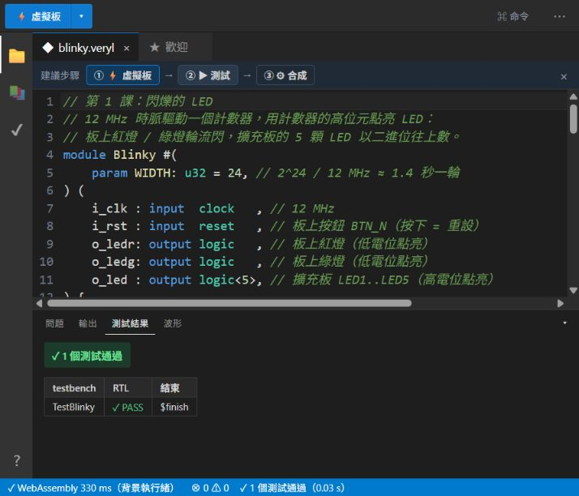
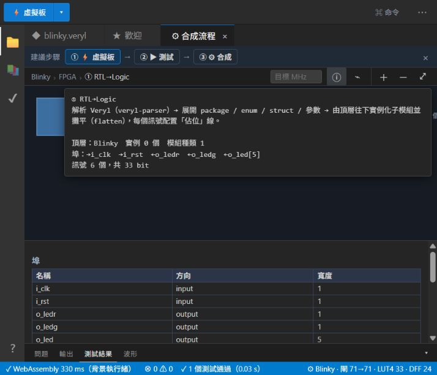

# IC EDA 實作報告

## 以 Veryl2chip 完成 RTL 模擬與邏輯合成

- 實驗日期：2026 年 10 月 29 日
- 工具：Veryl2chip Web IDE
- 設計案例：Blinky 可參數化計數器

## 摘要

本報告說明 IC 設計中的電子設計自動化 EDA，並以瀏覽器版 Veryl2chip 實際完成可參數化計數器的 RTL 驗證與邏輯合成。測試平台檢查重設值、計數至 37 的輸出與 6 位元溢位回零；1 個測試全部通過，執行時間為 0.03 秒。合成後得到 24 個 DFF、33 個 LUT4，工具顯示 71 個邏輯閘，且無錯誤或警告。

## 1 什麼是 IC 設計的 EDA

EDA 是 Electronic Design Automation 的縮寫，指使用軟體協助設計、分析、驗證與製造積體電路。現代晶片包含大量狀態元件與邏輯連線，單靠人工畫圖不容易維持一致性，也難以重複驗證。EDA 將設計意圖轉為可執行、可檢查的模型，再逐步轉換為邏輯閘、技術元件、配置繞線與製造版圖。

| 階段 | 主要工作 | 本實驗對應 |
|---|---|---|
| 設計輸入 | 以 HDL 描述暫存器、組合邏輯與介面 | Veryl 模組 Blinky |
| 功能驗證 | testbench、assertion 與波形 | 重設、計數 37、溢位回零 |
| 邏輯合成 | RTL 轉換並最佳化為閘級網表 | DFF、LUT4 與閘數 |
| 實體設計 | 技術映射、布局、繞線、時序與功耗 | 本次未延伸至完整 P&R |
| 簽核製造 | DRC、LVS、STA 與版圖輸出 | ASIC 後端流程 |

## 2 實驗目標與工具

- 理解 RTL、testbench、模擬與合成的關係。
- 使用可參數化計數器產生 LED 輸出，並以 assertion 自動判斷結果。
- 讀取合成後的資源數量，區分功能正確性與硬體成本。

Veryl2chip 是 Veryl HDL 的開源 EDA，可在瀏覽器中執行模擬、波形檢視、邏輯合成、FPGA 與 ASIC 流程。本次使用線上 IDE，避免安裝與環境差異。

## 3 電路設計

### 3.1 架構與行為

Blinky 以 `WIDTH` 參數決定計數器位寬。每次時脈有效邊緣到來時，若重設有效，`cnt` 清為 0；否則加 1。`o_led` 取計數器最高 5 位，`o_ledr` 與 `o_ledg` 分別取最高位的反相與原值。實體目標預設 `WIDTH=24`；測試時改為 6，使溢位能在 64 個週期內觀察。

| 訊號 | 方向 | 寬度 | 功能 |
|---|---:|---:|---|
| i_clk | 輸入 | 1 | 時脈 |
| i_rst | 輸入 | 1 | 同步重設 |
| o_ledr | 輸出 | 1 | 最高位反相 |
| o_ledg | 輸出 | 1 | 最高位 |
| o_led | 輸出 | 5 | 計數器最高 5 位 |

### 3.2 關鍵程式

```veryl
module Blinky #(param WIDTH: u32 = 24,) (
    i_clk : input  clock,
    i_rst : input  reset,
    o_ledr: output logic,
    o_ledg: output logic,
    o_led : output logic<5>,
) {
    var cnt: logic<WIDTH>;

    always_ff {
        if_reset {
            cnt = 0;
        } else {
            cnt = cnt + 1;
        }
    }

    assign o_ledr = !cnt[WIDTH - 1];
    assign o_ledg =  cnt[WIDTH - 1];
    assign o_led  =  cnt[WIDTH - 1:WIDTH - 5];
}
```

測試平台將 `WIDTH` 設為 6，依序檢查重設、計數至 37，以及 64 週期後溢位回零。

## 4 驗證方法與結果

| 檢查點 | 預期值 | 結果 |
|---|---|---|
| 重設後 | led=00000、ledr=1、ledg=0 | 通過 |
| 第 37 週期 | 37=100101，led=10010；最高位為 1 | 通過 |
| 再前進 27 週期 | 總數 64，6 位元計數器回到 0 | 通過 |



**圖 1　Veryl2chip 測試結果：1 個測試通過，執行時間 0.03 秒。**

自動 assertion 能明確定義通過條件，也能在設計修改後重複執行，因此比只靠目視波形更適合回歸測試。

## 5 邏輯合成與結果分析

RTL 到 Logic 合成後，工具辨識頂層為 Blinky，列出 5 組連接埠、6 個訊號與 33 個訊號位元。狀態列顯示 71 個邏輯閘、33 個 LUT4 與 24 個 DFF。

| 合成指標 | 數值 | 解讀 |
|---|---:|---|
| DFF | 24 | 24 位元計數器的狀態暫存 |
| LUT4 | 33 | 加法與輸出邏輯的查找表映射 |
| 邏輯閘 | 71 | 工具顯示的邏輯規模 |
| 訊號 | 6 組，共 33 bit | 5 組 I/O 加上內部 cnt |
| 診斷 | 0 error、0 warning | 設計與合成無診斷問題 |



**圖 2　RTL 到 Logic 合成畫面與埠、訊號統計。**

24 個 DFF 正好對應預設 `WIDTH=24` 的 `cnt` 暫存器，表示狀態儲存成本與 RTL 位寬一致；LUT4 與其他邏輯則實作加法、選位與輸出反相。

## 6 討論

### 6.1 EDA 的工程價值

本次流程把同一份 RTL 接到自動測試與合成，形成可追蹤的證據鏈：

1. 原始碼定義設計意圖。
2. Assertion 定義功能正確性。
3. 合成報告量化硬體成本。

功能測試通過不代表面積、速度與功耗已達最佳；資源數量良好也不能取代功能驗證。EDA 的價值在於讓不同工程觀點可以反覆驗證與比較。

### 6.2 限制與後續工作

- 本次只完成 RTL 驗證與第一階段邏輯合成，尚未執行完整 FPGA 或 ASIC 配置繞線。
- 未設定時脈限制，因此不能宣稱已完成時序收斂；後續應加入 SDC 並執行 STA。
- 可增加隨機測試、更多重設時機與閘級模擬。
- ASIC 後端還需標準元件映射、CTS、布局繞線、功耗分析、DRC 與 LVS。

## 7 結論

EDA 是把 IC 設計從文字描述推進到可驗證、可量測與可製造實體的自動化工具鏈。本實驗使用 Veryl2chip 驗證 24 位元計數器：1 個 testbench 全數通過，合成結果與 RTL 結構一致，而且沒有錯誤或警告。好的 EDA 流程同時回答兩個問題：電路是否做對，以及實作成本是否合理。

## 參考資料

1. [ccc-eda veryl2chip GitHub Repository](https://github.com/ccc-eda/veryl2chip)
2. [Veryl2chip Web IDE](https://ccc-eda.github.io/veryl2chip/web/dist/index.html)
3. [Cornell University ECE 5745 Complex Digital ASIC Design](https://www.csl.cornell.edu/courses/ece5745/handouts.html)
4. [ccc-eda EDA 電子書](https://github.com/ccc-eda/eda-books/tree/main/book)

存取日期：2026 年 10 月 29 日
